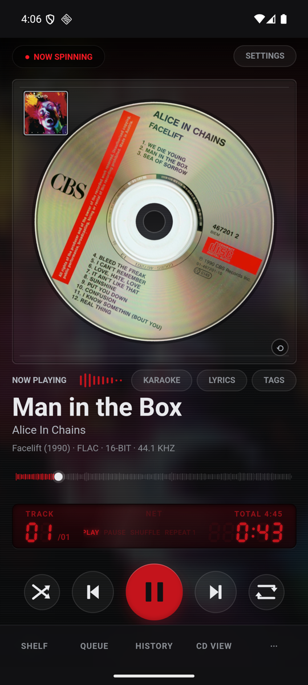
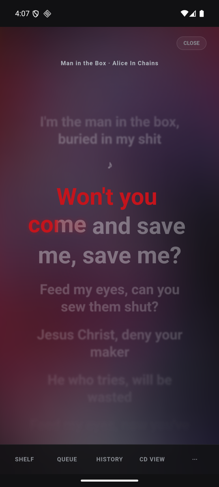
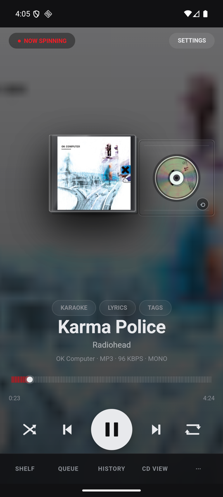
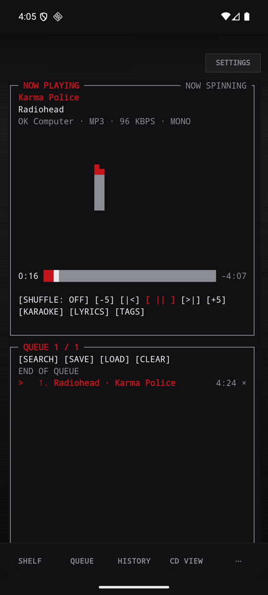
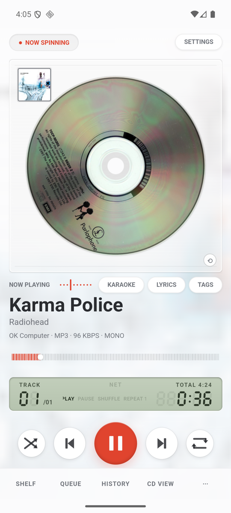

# CDPlayer for Android

[CDPlayer](https://github.com/Kizarov3/CDPlayer), the music player that feels like a real CD player, on your phone: the music already on it stands on a shelf as albums, a disc spins as it plays, and it all ages the way real CDs do. No account, no ads. MP3, M4A/ALAC, FLAC, WAV, OGG and Opus.

[](https://ko-fi.com/Kizarov3)

<p align="center">
  
  
  
  
  
</p>

## Download

Take `CDPlayer-x.y.z-android.apk` from [**Releases**](https://github.com/Kizarov3/CDPlayer-Android/releases/latest) on the phone and open it. Android asks once to let your browser (or file manager) install apps: allow it, then **Install**.

- **Android 10 or newer.** It runs in Android System WebView 105 or newer; on an older one CDPlayer says so and links to its update.
- **On first start** it asks for notifications (the player on the lock screen and in the notification shade), music, and photos (the covers and booklet scans in your album folders). Writing tags or found covers into your files asks for **All files access**, only when you turn that on.
- **Updates:** when a new version is out, an **AVAILABLE** button appears at the top: tap it to download the update (checked against the release's SHA-256), then **INSTALL** — Android asks once to let CDPlayer install apps. The new version goes over the old one with everything kept. (Before 2.25.0 the button opened the release page.)
- **Unverified developer:** Google is starting to ask apps installed from outside Play to come from verified developers. From September 30, 2026 in Brazil, Indonesia, Singapore and Thailand (elsewhere from 2027), Android may make you turn on **Allow apps from unverified developers** and wait 24 hours before installing.

The release APK is signed with the certificate whose SHA-256 is
`C1:92:B2:09:FB:38:6A:80:3E:7F:53:A3:17:0B:DB:89:20:C1:A7:42:EE:B5:27:25:98:F8:61:A8:8D:A0:ED:5E`.

## What's on the phone

Nearly all of the desktop CDPlayer: the shelf with its dust, dividers, notes and editions; the CD changer and the queue; every look (CLASSIC, VISUALIZER, LYRICS, HI-FI, ALBUM, JEWEL CASE, TERMINAL) and theme; gapless, AUTOMIX, the equalizer, crossfeed and Sound Check; playback with the screen off, from the lock screen and headset buttons; covers, disc photos and booklet scans; lyrics and karaoke with each word timed by the singing; YouTube Music and SoundCloud; Spotify (Premium); mini mode (picture-in-picture, with the cover and the buttons); TAKE ALONG to a folder, an SD card or a USB stick; choosing the output (the phone's own switcher); MusicBrainz, Discogs, APPRAISE and the WANT LIST; Last.fm and ListenBrainz scrobbling; BLIP; share cards and videos; backup and restore, and importing plays.

Not on the phone: audio CDs and ripping, the phone remote, Discord status, QUALITY's output-rate switching and the disc on the app icon.

So far CDPlayer for Android has been tested on Android emulators only. If something's wrong on your phone, please open an [issue](https://github.com/Kizarov3/CDPlayer-Android/issues) with your phone's model and **COPY REPORT** from Settings → HELP.

## Building it

Node 22 or newer, the Android SDK (`ANDROID_HOME`, platform 36) and JDK 21:

```sh
npm ci
node scripts/build-android.mjs            # debug APK; --install puts it on a connected phone or emulator
node scripts/build-android.mjs --release  # signed if ~/.cdplayer-signing/keystore.properties (or $CDP_SIGNING) names a key
npm test
```

The app is the desktop CDPlayer's own code (`src/main`, `src/renderer`) running in the WebView, with what Node and Electron would give it supplied by `src/android/shims` and the Java plugins in `android/`. Karaoke's word timing uses Spleeter (Deezer, MIT; as ONNX by sherpa-onnx, Apache-2.0), fetched by the build, and LyricsAlignment-Multilingual's model (MIT) with the CMU Pronouncing Dictionary (BSD).

## По-русски

CDPlayer для телефона: музыка с телефона стоит на полке альбомами, диск крутится, пока играет, и всё стареет, как настоящие CD. Скачайте `CDPlayer-x.y.z-android.apk` из [**Releases**](https://github.com/Kizarov3/CDPlayer-Android/releases/latest) прямо на телефоне и откройте; Android один раз спросит разрешение устанавливать приложения из браузера. Нужен Android 10 или новее. Обновления: вверху появится кнопка **AVAILABLE** — она скачает новую версию и поставит её поверх старой, всё сохраняется. Пока проверено только на эмуляторах: если что-то не так, откройте [issue](https://github.com/Kizarov3/CDPlayer-Android/issues) с моделью телефона и **COPY REPORT** из Настройки → HELP.

## License

[MIT](LICENSE)
